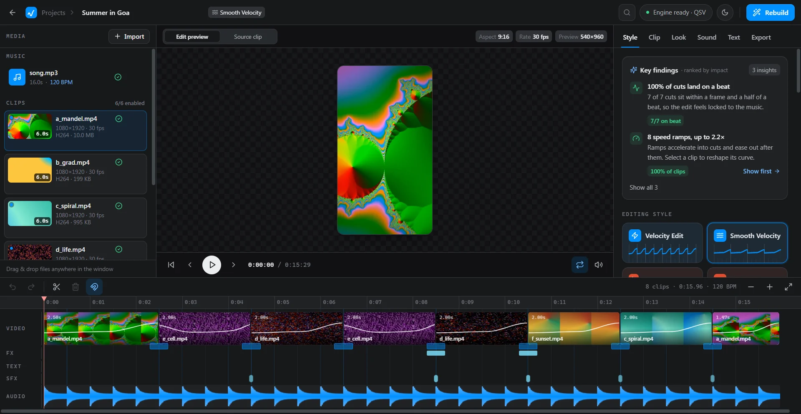

# ReelForge

**Drop clips + a song → get a beat-synced reel.** ReelForge is a Windows app that cuts your footage on every beat, adds speed ramps, transitions, sound effects and lyric captions, and exports a finished reel for Instagram, YouTube Shorts and TikTok. It runs on your PC, with no uploads and no account.

**Website:** https://reelforge-beige.vercel.app
**Download:** [ReelForge-Setup-x64.exe](https://github.com/Ashutosh258/ReelForge/releases/latest/download/ReelForge-Setup-x64.exe) (Windows 10 / 11, 64-bit)

## Features

- Beat detection and automatic arrangement: cuts land on the beat, the drop gets the big moment
- 28 editing styles: Velocity, Cinematic, Beat Sync, Glitch Core, Retro Tape, Night Drive, Lyrics and more
- Velocity speed ramps with motion blur, editable speed curves
- Lyric captions from offline transcription or an `.lrc` file
- Beat-synced sound effects and music automation
- Timeline editor: reorder, trim with beat snapping, split, transitions, effects, colour, text, undo / redo
- Export 720p to 4K, 24 / 30 / 60 fps, H.264 / H.265, GPU encoding when available, no watermark

## Pricing

Editing and previewing are free. Exporting is a one-time **₹299** unlock per PC, paid by UPI:

1. Click **Export** in the app. It shows a UPI QR with the amount filled in.
2. Pay with any UPI app.
3. Enter the 12-digit UPI transaction ID and send it by email from the app.
4. Paste the unlock key you receive by email.

Questions: anandashutosh324@gmail.com

## Installing

Run the installer. ReelForge isn't code-signed yet, so Windows SmartScreen may say *"Windows protected your PC"*: click **More info → Run anyway**.

## Third-party software

The installer includes FFmpeg (GPL v3, gyan.dev build); its licence and source links are in the install folder (`bin\FFMPEG-LICENSE.txt`, `THIRD_PARTY_NOTICES.txt`). FFmpeg source code: https://ffmpeg.org/download.html.
